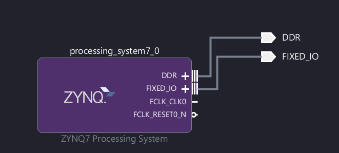

# MNIST MLP on a Zynq with AIfES

Third part of the Embedded AI course at MINES Saint-Étienne. This time the goal is to use an open-source tool instead of X-CUBE-AI: I converted the same MLP as in the [STM32 project](../MNIST%20MLP%20on%20an%20STM32L4R9%20with%20X-CUBE-AI) to C with [AIfES](https://github.com/Fraunhofer-IMS/AIfES_for_Arduino) (Fraunhofer IMS) and run it on the ARM Cortex-A9 of a ZedBoard (Zynq-7020), in float32 (F32) and in 8-bit quantized (Q7) versions.

## Converting the model with AIfES

The model is the same `5dense-mnist-10class-finetuned.h5` (784 → 512 → 256 → 128 → 64 → 10, 575,050 parameters, inputs normalized as `x / 255 - 0.5`). The last cells of the [training notebook](../MNIST%20MLP%20on%20an%20STM32L4R9%20with%20X-CUBE-AI/notebooks/MLP_mnist_training.ipynb) call the AIfES converter:

- `keras2aifes.convert_to_fnn_f32()` gives `aifes_f32_fnn.h` and `aifes_f32_weights.h`
- `keras2aifes.convert_to_fnn_q7()` gives the Q7 version, using 1000 training images to compute the quantization parameters

Each pair of files has the weights and two functions, `..._create_model()` and `..._inference(input, output)`. The input is always given in float: the Q7 version quantizes it inside the inference function and converts the output back to float. The F32 weights take 2,300,200 bytes (2.19 MiB) and the Q7 ones 578,044 bytes (564 KiB), about 4 times less.

The notebook also writes `test_data.h` with 100 test images (already normalized), their labels and the Keras predictions, so the board can be compared with the PC. Keras gets 99 of them right: the only error is image 49, a 9 predicted as 4.

## Hardware (Vivado 2026.1)

The design only uses the processing system: a ZYNQ7 Processing System block with the ZedBoard preset (DDR, UART1 and clocks), nothing in the programmable logic. I disabled the M_AXI_GP0 port since nothing is connected to it, generated the bitstream and exported the hardware as `design_1_wrapper.xsa`.

<p align="center">
  
</p>

## Software (Vitis 2026.1)

I created a platform from the `.xsa` (standalone, `ps7_cortexa9_0`) and an application from the Hello World template. The `src` folder of the application contains:

- `main.c` (instead of `helloworld.c`) and `platform.c/h` from the template
- the four files generated by AIfES and `test_data.h`
- the AIfES library from `AIfES_for_Arduino/src`: the headers at the root and the `basic`, `core` and `cnn` folders

A few things had to be adapted because AIfES_for_Arduino is made for Arduino boards:

- `aifes_config.cpp` is removed. It's Arduino code, and a single `.cpp` file makes Vitis build the whole project as C++. The two print functions it provides, `aiprint()` and `aiprint_uint()`, are written in `main.c` with `printf`.
- The `cmsis` (Cortex-M) and `avr_pgm` (AVR) folders are excluded from the build.
- `cnn` is only needed for its headers, because `aifes.h` includes them.
- In Vitis 2026.1 the A9 global timer is accessed through `xiltimer.h` (`xtime_l.h` doesn't exist anymore).

The build settings are in `vitis/UserConfig.cmake`: the include folders, the math library (`m`, needed for the softmax) and `-O2`. The AIfES sources are added with `list(APPEND ...)` on a separate line, because Vitis rewrites the `USER_COMPILE_SOURCES` list on its own when files are added or removed in `src`. In `lscript.ld`, heap and stack are set to 0x200000 (2 MB each) and everything stays in DDR.

The F32 build gives a 2.73 MB `.text` section (weights, test images and code) and 4.2 MB of `.bss` (heap and stack).

`main.c` creates the model, runs the 100 images and prints over UART (115200 baud) the accuracy, the agreement with Keras and the mean inference time measured with the A9 global timer. Uncommenting `#define USE_Q7` switches to the quantized model.

## Results

Both versions were run on the ZedBoard with the 100 images of `test_data.h`. The serial logs are in `results/`.

| | F32 | Q7 |
|---|---|---|
| Accuracy in Keras (float model, 100 images) | 99 % | 99 % |
| Accuracy on the ZedBoard (100 images) | 99/100 | 99/100 |
| Agreement with Keras | 100/100 | 100/100 |
| Weights size | 2.19 MiB | 564 KiB |
| Inference memory (buffers between layers) | 6,272 B | 1,588 B |
| Inference time | 7.89 ms | 1.26 ms |

Both versions give the same answer as Keras on every image, including the one Keras gets wrong (image 49, a 9 read as 4). So the conversion to C works, and on these images the 8-bit quantization doesn't change any prediction. As in the STM32 project, the Q7 outputs show 0.996 instead of 1.0 because the softmax output is stored on 8 bits.

The Q7 model uses about 4 times less memory, both for the weights and for the inference buffers, which is what you expect going from 4 bytes to 1 byte per value. The speed gain is bigger than that: Q7 is 6.3 times faster (about 794 images per second against 127). My guess is that memory access is the main reason. The F32 weights (2.19 MiB) are much bigger than the 512 KB L2 cache of the Zynq, so they are read again from DDR at every inference, while the Q7 weights almost fit. Integer multiply-accumulate is also cheaper than float on the A9. I didn't test the two effects separately.


## Repository content

```
aifes/       files generated by AIfES (F32 and Q7)
vivado/      block design
vitis/       main.c, UserConfig.cmake and test_data.h
results/     serial logs of the board (F32 and Q7)
```

The AIfES library is not copied here, it comes from the [AIfES_for_Arduino](https://github.com/Fraunhofer-IMS/AIfES_for_Arduino) repository.

The notebook, the AIfES converter and the slides were given in the course, and I adapted them for this assignment.
