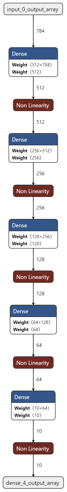
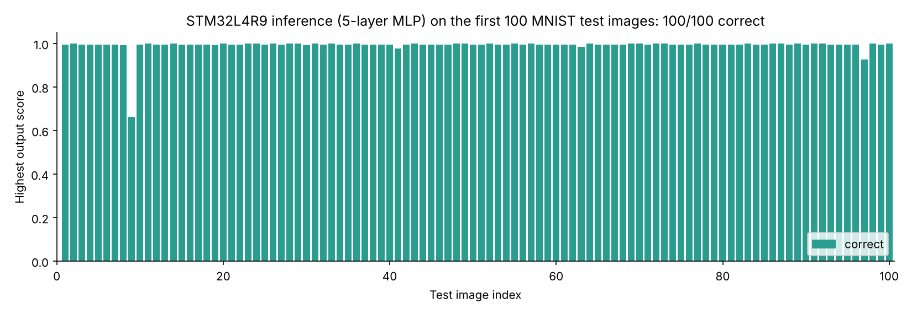

# MNIST MLP on an STM32L4R9 with X-CUBE-AI

Second part of the Embedded AI course at MINES Saint-Étienne. After the small CNN of the [first project](../MNIST%20on%20an%20STM32L4R9%20with%20X-CUBE-AI), I deployed a much bigger fully connected network on the same STM32L4R9I-DISCO board. In float32 its weights take 2.19 MiB, which is more than the 2 MB of flash on the chip, so it only fits thanks to the X-CUBE-AI compression.

The board, the UART protocol and the PC script are the same as before.

## Training the model

The notebook is `notebooks/MLP_mnist_training.ipynb` (Keras, TensorFlow 2.15.1). The network takes the flattened image (784 values) and has four ReLU dense layers plus a softmax output:

```
784 → 512 → 256 → 128 → 64 → 10
```

That's 575,050 parameters. I balanced the dataset so every digit has the same number of images, normalized the pixels as `x / 255 - 0.5` and trained for 20 epochs with Adam (lr 1e-3, batch size 128). Test accuracy is 97.70 % on the balanced test set and 97.75 % on the full 10,000 MNIST test images.

The last cells (AIfES export and a C header with test images) are for another target and aren't used here.

## Importing it in CubeMX

Same settings as for the CNN: X-CUBE-AI 10.2.0, Application Template, low compression, balanced optimization, `stm32l4` target. CubeMX shows each Dense layer as a dense block followed by its activation:

<p align="center">
  
</p>

With low compression, the weights of the three biggest layers are stored as 8-bit indexes into a table of 256 float values, while the last two layers stay in float32. The weights go down to 593 KiB (−73.6 %). The analysis reports 576,160 MACC per inference, 604 KiB of flash and 8 KiB of RAM in total with the runtime. The full report is in `results/mnist_analyze_report.txt`.

## Firmware and PC script

`firmware/main.c` and `firmware/app_x-cube-ai.c` are the same as in the first project, only the generated network changes.

`host/test.py` has one change compared to the CNN version. The `.npy` test set has pixels between 0 and 1, but this model was trained on [-0.5, 0.5], so the script subtracts 0.5 before sending each image. Without it the accuracy drops a lot: evaluating the model in Keras on the full test set gives 92.51 % instead of 97.75 %.

Out of curiosity I also ran the board without the shift: 96/100. The four errors are all 4s (three read as 9, one as 0 with a score of 0.996), and they are the same ones the model gets wrong on the PC with the same input. So the board behaves like the model, it's only the input that is wrong. The log is in `results/stm32_evaluation_log_no_shift.txt`.

The script reuses the test set from the first project's `model/` folder so the 63 MB file isn't stored twice:

```bash
pip install pyserial numpy
cd host
python test.py
```

## Results

100 out of 100 images were classified correctly on the board. The log is in `results/stm32_evaluation_log.txt`.



The least confident case is image 9, a 5 with a score of 0.66. Like before, 0.996 instead of 1.0 just comes from the `uint8` cast on the MCU, and 100 images is a small sample, so 97.75 % is the number to keep for the model. The compression didn't seem to cost anything: the board gives the same answers as Keras on these images.

## CNN vs MLP

| | CNN | MLP |
|---|---|---|
| Parameters | 6,478 | 575,050 |
| MACC / inference | ~24k | 576k |
| Flash (weights) | 8.1 KB | 593 KiB |
| RAM (activations) | 3.9 KB | 5.1 KiB |
| Test accuracy (10k images) | 95.77 % | 97.75 % |
| On the board (100 images) | 99/100 | 100/100 |

The MLP is about 2 points better but needs around 75 times more flash. For a microcontroller the CNN is the more reasonable choice.

## Repository content

```
notebooks/MLP_mnist_training.ipynb    training notebook (with outputs)
model/                                .h5 model
firmware/                             main.c and app_x-cube-ai.c
host/test.py                          UART evaluation script
results/                              model graph, analysis report, board logs (with and without the shift) and plot
```

The notebook, the UART script and the application template were given in the course and adapted for this assignment.
