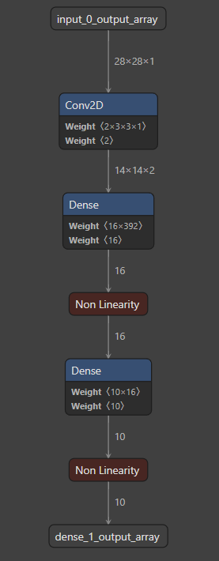
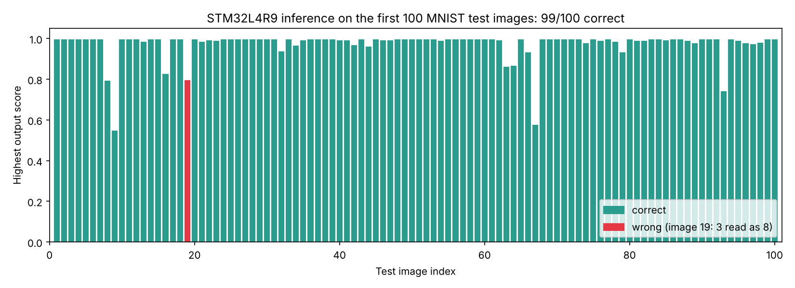

# MNIST on an STM32L4R9 with X-CUBE-AI

This is my work for the Embedded AI course at MINES Saint-Étienne. The goal was simple to state: train a very small CNN on MNIST, convert it to C with STM32Cube.AI, run it on an STM32L4R9I-DISCO board, and check from a PC that the board gives the same answers as the model did in Python.

The PC sends a 28×28 image over UART, the board runs the inference, and it sends back ten scores, one per digit.

## Training the model

I trained the network in Google Colab with Keras (`notebooks/Embedded_AI_colab.ipynb`). It is deliberately tiny so it fits comfortably in a Cortex-M4: one 3×3 convolution with 2 filters, a 2×2 max pooling, a dense layer of 16 neurons and a softmax over 10 classes. That adds up to 6,478 parameters.

I used Adam, batch size 128 and only 5 epochs. On the 10,000 MNIST test images it reaches 95.77 % accuracy, which is fine for a network this small. The notebook also saves the `.h5` model and the test set as `.npy` files, which CubeMX needs later for validation.

## Importing it in CubeMX

I imported the `.h5` in STM32CubeMX with X-CUBE-AI 10.2.0, using the Application Template, low compression and balanced optimization, targeting the `stm32l4` family. This is the graph CubeMX shows after the analysis:



The analysis says the network needs about 24k multiply-accumulates per inference. In memory, the weights take 8.1 KB of flash (68.7 % less than the float model, thanks to the compression). The complete report is in `results/mnist_analyze_report.txt`.

## Firmware

The code comes from the CubeMX template, and I edited the user sections in `firmware/main.c` and `firmware/app_x-cube-ai.c`. The board talks over USART2 at 115200 baud. When it starts it waits for the PC to send `0xAB` and answers `0xCD`. After that it loops: receive 3136 bytes (784 float32 pixels), run `ai_run()`, then send 10 bytes.

Those 10 bytes are the softmax outputs multiplied by 255 and cast to `uint8`, so the PC divides by 255 to recover a score between 0 and 1.

## Testing from the PC

`host/test.py` loads the saved MNIST test set, synchronises with the board and sends the first 100 images one by one, comparing the highest score with the expected label. You only need to set `PORT` to the board's virtual COM port, then:

```bash
pip install pyserial numpy
python host/test.py
```

## Results

On the board, 99 of the 100 images were classified correctly. The only miss is iteration 19, a 3 that the network read as an 8 (with a score of about 0.80 for the 8). The full log is in `results/stm32_evaluation_log.txt`.



Two things are worth knowing when reading the log. First, most "confident" outputs show 0.996 instead of 1.0. That is just the `uint8` cast on the MCU truncating a value like 0.9999 to 254/255, and it doesn't change the predicted class. Second, 99 % on 100 samples is a small sample and ends up above the 95.77 % measured on the whole test set, so the second number is the one that really represents the model.

## Repository content

```
notebooks/Embedded_AI_colab.ipynb     Colab notebook used for training (with outputs)
model/                              .h5 model and .npy test data
firmware/                           main.c and app_x-cube-ai.c
host/test.py                        UART evaluation script
results/                            model graph, X-CUBE-AI analysis report, board log and plot
```

The notebook, the UART script and the application template were given in the course, and I adapted them for this assignment.
